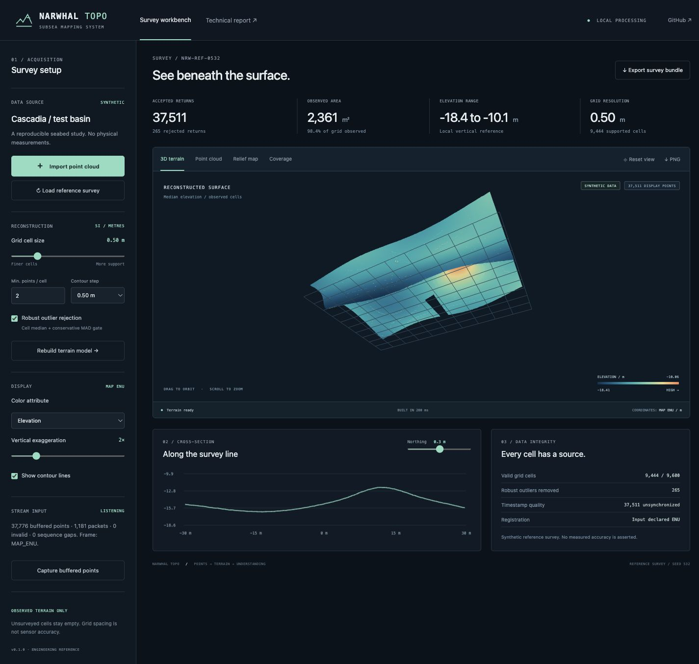

# Narwhal Topo

**Turn underwater LiDAR returns into an inspectable terrain model.**

Narwhal Topo is a local survey workbench and Python processing pipeline for point-cloud inspection, observed-cell terrain reconstruction, contour mapping, cross-sections and portable survey exports. It accepts outputs from [Narwhal Two Plus](https://github.com/jeremedotxyz/narwhal-two-plus) and other sources that can provide supported point records.

The browser workbench runs against a local Python service. The service can receive proposed **NWP1** packets over UDP or import CSV, JSONL and ASCII PLY. Mapping includes optional registration against an external timestamped pose trajectory. A seeded seabed scene is included so every view and export can be exercised without hardware.

**Status: working software reference, version 0.1.0.** Real sensor deployment requires compatible point packets, correct coordinates, validated calibration, clock alignment and navigation. The included survey is explicitly synthetic. No physical accuracy, hydrographic certification, SLAM capability or achieved subsea resolution is claimed.



## Run the workbench

Python 3.10+ is sufficient. There are **no third-party runtime dependencies**, no CDN scripts and no API keys.

```bash
git clone https://github.com/jeremedotxyz/narwhal-topo.git
cd narwhal-topo
PYTHONPATH=src python3 -m narwhal_topo serve --port 8766
```

Open **http://127.0.0.1:8766/**. It starts with the synthetic reference survey. All processing and uploaded data remain on the machine running the service; nothing is sent to GitHub by the workbench.

On Windows PowerShell, set `$env:PYTHONPATH="src"` and run `python -m narwhal_topo serve`. An editable install is optional: `python3 -m pip install -e .` inside a virtual environment adds the `narwhal-topo` command. Run from the source checkout, which supplies the `web/` assets; standalone wheel deployment is not packaged in this version.

## What is implemented

| Capability | Behavior |
|---|---|
| 3D terrain | WebGL triangle surface generated from supported neighboring grid cells; orbit, zoom and vertical exaggeration |
| Point-cloud viewer | Accepted returns, with an explicit 60,000-point display cap; numerical processing and exports retain all accepted points |
| Relief map | North-up, elevation-colored raster and contour overlay |
| Coverage map | Observed-cell support; empty and undersupported cells remain empty |
| Cross-section | Select a northing row and inspect the elevation profile; gaps remain gaps |
| Cell inspection | Click the plan map for center coordinates, elevation, count and sampling proxy |
| Reconstruction controls | Cell size, minimum count, conservative MAD spike rejection and contour interval |
| Color attributes | Elevation, return intensity, point count and a sampling uncertainty proxy |
| Registration | Quaternion SLERP + linear translation from externally supplied sensor poses; optional rigid mounting transform in CLI |
| Stream input | Bounded NWP1 UDP receive buffer, packet validation and loss/order diagnostics; user-triggered reconstruction snapshots |
| Exports | ZIP with full accepted CSV/PLY, numerical grid, ASCII raster, terrain PNG, SVG/local-JSON contours, provenance and statistics |
| Reproducibility | Analytic synthetic scene, committed numerical results, test suite and GitHub Actions checks |

## First workflow

1. Explore the reference scene with **3D terrain**, **Point cloud**, **Relief map** and **Coverage**.
2. Change cell size or point support and choose **Rebuild terrain model**.
3. Select a northing with the cross-section slider. Click a relief-map cell to inspect its support.
4. Choose **Import point cloud**, select a supported file and explicitly identify its frame.
5. For moving sensor-frame scans, provide the sensor trajectory in map ENU. Use the CLI for additional mounting extrinsics.
6. Choose **Export survey bundle** to retain the numerical map and provenance. PNG in the viewer exports the current graphical view.

Selecting finer cells does not create measurements or improve sensor precision. At insufficient density, smaller cells produce more holes. This is intentional.

## Coordinate modes

- **MAP_ENU:** input points are already registered in a local metre frame: X east, Y north, Z up. Negative Z can represent seabed elevations below a chosen zero. The zero is not automatically a tidal/chart datum.
- **SENSOR_LOCAL:** inspection of individual sensor coordinates. For the concept sensor, X right, Y down, Z forward. Z is forward distance, not bathymetric depth. A single scan line may have no two-dimensional surface support; the workbench then opens the cloud view.
- **POSE_REGISTERED:** sensor points are transformed into ENU using external positions/orientations and timestamps. Pose and point time bases must match. No extrapolation is allowed.

There is no automatic ICP/SLAM, geographic CRS assignment, GNSS/INS processing, water refraction calibration or datum conversion. The accepted formats deliberately do not include LAS/LAZ or GeoTIFF; use an external GIS adapter and verified metadata if those are required.

## Connect a packet source

```bash
PYTHONPATH=src python3 -m narwhal_topo serve --port 8766 --udp-port 53200
```

This defaults the UDP data to **SENSOR_LOCAL**. Once packets arrive, choose **Capture buffered points**. It reconstructs a bounded snapshot rather than continuously changing the map. Select the UDP frame at startup only when the sender's frame is known.

For an end-to-end synthetic network test, start a separate server with explicitly declared ENU:

```bash
PYTHONPATH=src python3 -m narwhal_topo serve --udp-port 53200 --udp-frame MAP_ENU
# In a second terminal:
PYTHONPATH=src python3 -m narwhal_topo udp-demo --port 53200
```

`udp-demo` sends synthetic ENU points, not sensor-local readings. NWP1 is the proposed point protocol documented in Narwhal Two Plus; no physical sensor is currently known to implement it. A physical ADC/FPGA driver must deliver compatible data before this becomes a hardware workflow. The application has no laser enable/control path.

## Batch processing

```bash
PYTHONPATH=src python3 -m narwhal_topo build examples/synthetic-survey.csv \
  --frame MAP_ENU --cell 0.5 --min-points 2 --out runs/imported.zip

PYTHONPATH=src python3 -m narwhal_topo build measured-points.jsonl \
  --frame POSE_REGISTERED --poses sensor-poses.csv --extrinsics mounting.json \
  --cell 0.5 --out runs/registered.zip

PYTHONPATH=src python3 -m narwhal_topo demo --out runs/reference.zip
PYTHONPATH=src python3 examples/reproduce.py
PYTHONPATH=src python3 -m unittest discover -s tests -v
```

The second command is a usage example requiring the user's real files. Data contracts, units and limits are in the [input specification](docs/data-contracts.md). Scientific methods and evidence are in the [technical report](docs/technical-report.md).

## Documentation

| Document | Contents |
|---|---|
| [Technical report](docs/technical-report.md) | Design basis, equations, reconstruction, visualization, uncertainty, experiment and limitations |
| [Architecture](docs/architecture.md) | Data flow, module map, HTTP endpoints, state and processing lifecycle |
| [Data contracts](docs/data-contracts.md) | File schemas, coordinate frames, poses, NWP1 and export orientation |
| [Operator guide](docs/operator-guide.md) | Setup, import, live capture, tuning, troubleshooting and exports |
| [Verification record](docs/verification.md) | Tests, numerical checks, UI checks and what remains unverified |
| [Reference results](examples/reference-results.md) | Exact seeded multiresolution experiment results |
| [Roadmap](docs/roadmap.md) | Hardware integration, calibrated uncertainty, GIS adapters and deployment work |

## Practical bounds

Version 0.1.0 accepts at most 300,000 points and 250,000 cells per reconstruction. File text is limited to 32 MiB. Contour output is limited to 100 levels. The viewer can decimate display points to 60,000; the surface grid and exports are not derived from that display decimation. Processing is in memory, intended for bounded local surveys rather than a production acquisition recorder.

The service binds to 127.0.0.1 by default. It has no accounts, TLS or application authentication. Do not expose it as a public server. The optional UDP protocol has CRC integrity checks but no sender authentication or retransmission. See the deployment boundary in [architecture](docs/architecture.md).

No open-source license has been selected. No third-party sensor firmware, proprietary CAD or measured dataset is bundled. Contributions should preserve the distinction between analytic truth, synthetic output and physical measurements.

## Share artwork

The repository social preview matches the Narwhal Two Plus blueprint palette and sheet layout. The [1280 × 640 PNG](docs/assets/social-preview.png) and [editable SVG](docs/assets/social-preview.svg) are generated from the actual synthetic reconstruction, contours and cross-section. [Regenerate the artwork](scripts/generate_social_preview.py) with `PYTHONPATH=src python scripts/generate_social_preview.py`; only this optional artwork task requires Pillow.
