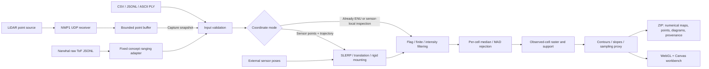

# Architecture and execution model

Narwhal Topo combines a standard-library Python processing service with a buildless browser interface. Python owns numerical results; the browser owns interaction and presentation. No data is uploaded to an external service by the application.

## Module responsibilities

| Module | Responsibility |
|---|---|
| `model.py` | Point and configuration contracts, resource bounds |
| `ingest.py` | File parsing, concept raw-ranging adapter, NWP1 CRC/record validation |
| `registration.py` | Pose timeline, quaternion interpolation and rigid transforms |
| `mapping.py` | Filtering, bounded XY grid, median surface, support/spread/proxy, slopes and contour segments |
| `export.py` | North-up PNG, ASCII raster, CSV, PLY, local contour JSON, SVG and archive |
| `demo.py` | Deterministic analytic synthetic seabed and sampled observations |
| `server.py` | Loopback HTTP interface, serialized reconstruction, bounded UDP buffer and atomic product replacement |
| `cli.py` | Serve, offline reconstruction, synthetic bundle and UDP demonstration |
| `web/app.js` | WebGL buffers, orbit camera, map rasterization, profiles, dialogs, API requests and downloads |

## Processing lifecycle

A startup synthetic survey produces a valid initial model. Import, rebuild and stream capture requests are serialized by a processing lock. A candidate result is computed before replacing the current raw dataset, settings, accepted points and map. A failed request retains the previous map. Snapshot GETs and exports use a state lock to avoid reading partially replaced products. The service runs in one process with threaded HTTP handlers; it is not a multiuser database.

The receiver runs in a daemon thread with a 300,000-point ring buffer. Old points are overwritten and the count is exposed. The map is not implicitly rebuilt on every datagram. This avoids presenting a constantly changing surface while an operator inspects a snapshot, but it is not a lossless recorder. Sequence diagnostics count missing forward sequence values and duplicate/out-of-order arrivals. Packets remain in arrival order and are not retransmitted or deduplicated.

## HTTP endpoints

| Route | Method | Contract |
|---|---|---|
| `/`, `/app.js`, `/style.css` | GET | Fixed local assets; arbitrary filesystem paths are not served |
| `/api/map` | GET | Current product, statistics, grid, contours and bounded display points |
| `/api/live` | GET | Receiver enable state, frame, packet counters and buffered count |
| `/api/export` | GET | ZIP for the current product and all accepted points |
| `/api/demo` | POST | Regenerate seed-532 survey; force ENU mode |
| `/api/import` | POST | Text, format, filename, settings and optional pose CSV/extrinsics |
| `/api/rebuild` | POST | Reconstruct current data with new numerical settings; preserve its frame |
| `/api/capture` | POST | Snapshot UDP buffer, using frame declared at service startup |

POST requires JSON. A supplied Origin must match the request Host. Requests above 40 MiB are rejected; point text has a stricter 32 MiB limit. These checks reduce accidental cross-site use but do not constitute an authenticated deployment design. HTTP is intentionally local and no CORS allowlist is opened. Files and exports remain in memory unless an operator saves them.

## Browser rendering

WebGL 1 uses position/color buffers and perspective shaders for terrain triangles, cloud points, floor-grid lines and contour overlays. A triangle quad requires all four neighboring grid centers to have supported elevations. The cloud display is capped at 60,000 samples by a deterministic stride; numerical exports keep the full accepted set. Vertical exaggeration affects visualization only.

Canvas 2D renders plan rasters, contours, axis labels and cross-sections. Grid rows run south to north internally; plan images reverse rows to place north at the top. NoData is transparent in terrain PNG and appears as an empty background in the workbench. Profile paths break at unsupported cells.

## Runtime and deployment boundary

The supported launch is a source checkout with Python >=3.10 and the `web/` directory beside `src/`. Editable installation is optional. A distributable wheel with packaged web assets, service authentication, TLS, durable projects, a database and multiuser access are future work. Normal operation requires a browser with WebGL for 3D; plan views remain available when WebGL context creation is unavailable.

The current server does not implement laser control, device discovery, authenticated hardware sessions, clock synchronization, navigation estimation, sensor calibration or water refractive-index estimation. Those capabilities belong at explicit integration boundaries rather than being inferred from a colorful surface.
